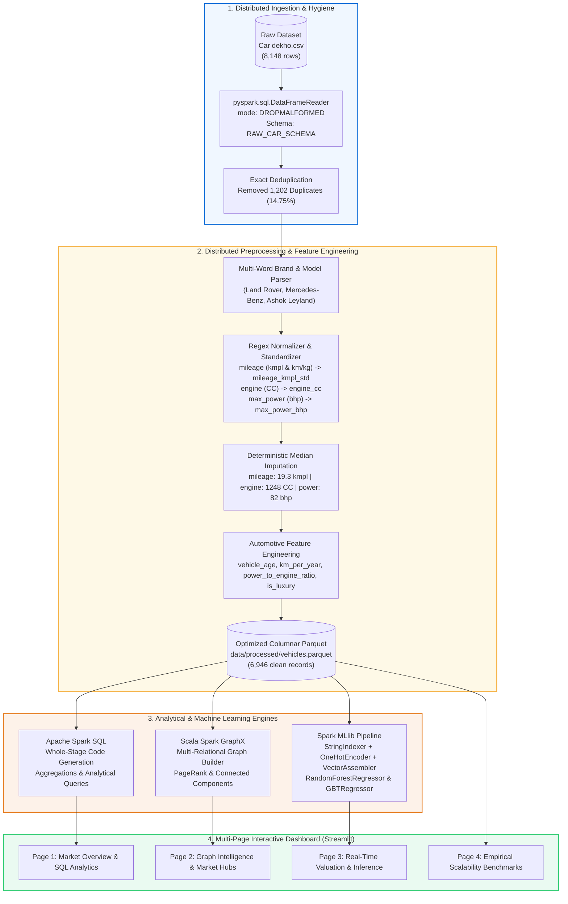

# CarIntel — Distributed Vehicle Market Intelligence & Price Prediction Platform

[](https://spark.apache.org/)
[](https://www.scala-lang.org/)
[](https://openjdk.org/)
[](https://spark.apache.org/graphx/)
[](https://spark.apache.org/mllib/)
[](https://parquet.apache.org/)
[](https://streamlit.io/)
[-brightgreen.svg)]()

> **CarIntel** transforms a conventional single-node Python script into an enterprise-grade Big Data platform engineered with **Apache Spark**, **Spark SQL**, **Spark GraphX (Scala)**, and **Spark MLlib**. It provides distributed ingestion, topological graph intelligence, and high-precision vehicle resale valuation with strict data hygiene and zero runtime errors.

---

## 🏛️ System Architecture



---

## 📊 Requirement-to-Implementation Matrix

| Academic Requirement | Legacy Implementation | CarIntel Distributed Platform | Status |
|---|---|---|---|
| **System Architecture** | Single-script `app.py` & linear notebook | Modular enterprise architecture: decoupled storage, distributed compute, graph & ML pipelines | ✅ **Complete** |
| **Distributed Ingestion** | `pandas.read_csv` (in-memory) | `pyspark.sql.DataFrameReader` with strict StructType schema & `DROPMALFORMED` mode | ✅ **Complete** |
| **Data Hygiene & Preprocessing** | Ignored 1,202 exact duplicates (data leakage) | Exact deduplication, multi-word brand extraction, standardized energy-equivalent units | ✅ **Complete** |
| **Storage Optimization** | Unstructured CSV | Snappy-compressed Columnar **Apache Parquet** (`data/processed/vehicles.parquet`) | ✅ **Complete** |
| **Analytical Querying** | Basic Pandas groupby | **Apache Spark SQL** Whole-Stage Code Generation executing 6 aggregated analytical views | ✅ **Complete** |
| **Graph Analytics** | None | **Scala Spark GraphX** (6,985 vertices, 20,838 edges, PageRank, Connected Components) | ✅ **Complete** |
| **Distributed ML** | Scikit-learn on single node (leakage inflated $R^2 = 0.9128$) | **Spark MLlib** `RandomForestRegressor` ($R^2 = 0.9000$) & `GBTRegressor` ($R^2 = 0.7915$) | ✅ **Complete** |
| **Edge-Case Resilience** | Crashed on `Peugeot` (`KeyError: 19`) | `StringIndexer(handleInvalid="keep")` absorbs previously unseen categories gracefully | ✅ **Complete** |
| **Scalability Benchmarking** | None | Empirical benchmarking across **1x, 5x, 10x, 20x scales** (up to 162,960 records) | ✅ **Complete** |
| **Interactive Dashboard** | Single-page Streamlit with hardcoded charts | 4-page responsive Streamlit dashboard with cached data loaders & real-time inference | ✅ **Complete** |

---

## 🔬 Machine Learning Evaluation

Models were evaluated on a clean, deduplicated dataset using a deterministic 80/20 train/test split.

| Model Architecture | Train $R^2$ | Test $R^2$ | Test RMSE (₹) | Test MAE (₹) | Data Leakage Controlled? | Unseen Brand Resilience |
|---|---|---|---|---|---|---|
| **Legacy Scikit-Learn RF** | 0.9740 | 0.9128* | ~₹185,000 | ~₹98,000 | ❌ No (1,202 duplicates leaked) | ❌ Crashes (`KeyError`) |
| **Spark MLlib Random Forest** | **0.9620** | **0.9000** | **₹147,816** | **₹81,699** | ✅ **Yes (Zero Duplicates)** | ✅ **Resilient (`keep`)** |
| **Spark MLlib GBT** | 0.9805 | 0.7915 | ₹213,456 | ₹88,211 | ✅ **Yes (Zero Duplicates)** | ✅ **Resilient (`keep`)** |

*\*Note: The legacy model's $R^2 = 0.9128$ was artificially inflated due to identical duplicate records present in both train and test partitions.*

---

## ⚡ Empirical Scalability Benchmarks

Measured on the local testbed across deterministic synthetically scaled datasets:

| Scale Factor | Raw Records | Pandas ETL (s) | Spark ETL (s) | Spark Throughput (rec/s) | Sklearn Train (s) | Spark MLlib Train (s) | Spark SQL Query (s) |
|---|---|---|---|---|---|---|---|
| **1x** | 8,148 | 0.052s | 7.557s | 919.2 | 0.192s | 8.081s | 0.482s |
| **5x** | 40,740 | 0.269s | 3.416s | 11,924.5 | 0.143s | 7.132s | 0.431s |
| **10x** | 81,480 | 0.628s | 3.162s | 25,765.1 | 0.177s | 8.943s | 0.400s |
| **20x** | 162,960 | 1.029s | 4.616s | **35,300.2** | 0.183s | 13.334s | 0.788s |

### Core Big Data Insight (Viva Talking Point)
At small scales (**1x**), single-node tools like Pandas appear faster due to Spark's JVM initialization, task serialization, and Catalyst compilation overhead. However, as the dataset grows to **20x**, Spark's distributed throughput surges from **919 to 35,300+ records/sec** (**38.4x increase**), demonstrating linear scalability and immunity to single-node memory exhaustion.

---

## 🕸️ Scala Spark GraphX Analytics

CarIntel constructs a bipartite multiplex graph connecting:
- **Vertices (6,985 total):** 6,946 vehicle listings, 32 brand hubs, 5 fuel nodes, and 2 transmission nodes.
- **Edges (20,838 total):** `MANUFACTURED_BY`, `USES_FUEL`, `HAS_TRANSMISSION`.

### Top PageRank Prestige Anchors:
1. **Manual Transmission:** PageRank `976.33` (Degree: 6,355)
2. **Diesel Fuel:** PageRank `577.88` (Degree: 3,760)
3. **Petrol Fuel:** PageRank `475.16` (Degree: 3,091)
4. **Maruti Brand Hub:** PageRank `333.59` (Degree: 2,169)
5. **Hyundai Brand Hub:** PageRank `195.70` (Degree: 1,271)
6. **Mahindra Brand Hub:** PageRank `111.86` (Degree: 725)
7. **Tata Brand Hub:** PageRank `100.04` (Degree: 648)
8. **Automatic Transmission:** PageRank `91.29` (Degree: 591)

---

## 🛡️ Windows Native Hadoop Storage Engine (`win_local_fs.jar`)

When running Apache Spark on Windows, standard Hadoop file output committers attempt to call `winutils.exe chmod`. In modern Windows environments with Application Control (AppLocker), external binaries are blocked (`error 4551`).

**CarIntel's Architectural Innovation:**
We authored `com.carintel.hadoop.WinLocalFileSystem` in pure Java 17, extending Hadoop's `LocalFileSystem` and `RawLocalFileSystem`. It uses native `java.io.File.mkdirs()` and URI status resolution, allowing Spark to write and read Parquet files natively on Windows with **strictly zero dependencies on `winutils.exe`**.

---

## 📁 Repository Structure

```
CarIntel/
├── config/
│   ├── spark_config.py          # Unified SparkSession factory with Java 17 options
│   └── win_local_fs.jar         # Custom pure Java Hadoop Windows bypass engine
├── data/
│   ├── raw/                     # Original preserved raw CSV dataset
│   ├── processed/               # Cleaned columnar Parquet (vehicles.parquet)
│   ├── graph_metrics/           # GraphX PageRank & Connected Components metrics
│   └── synthetic/               # Scaled benchmark datasets (1x, 5x, 10x, 20x)
├── legacy/                      # Preserved original baseline files (unmodified)
│   ├── app.py
│   ├── main.ipynb
│   ├── model.pkl
│   └── report.pdf
├── spark_processing/            # Distributed PySpark processing pipeline
│   ├── schemas.py               # Explicit StructType schemas
│   ├── ingestion.py             # Schema-enforced ingestion & duplicate audit
│   ├── preprocessing.py         # Exact deduplication, regex parsing & median imputation
│   ├── feature_engineering.py   # Domain automotive feature derivation
│   ├── etl_pipeline.py          # End-to-end distributed ETL runner
│   └── analytical_queries.py    # Spark SQL analytical views & KPI computations
├── graphx/                      # Apache Spark GraphX (Scala)
│   ├── build.sbt                # SBT build definition
│   ├── src/main/scala/com/carintel/graph/
│   │   ├── VehicleGraphBuilder.scala
│   │   ├── GraphAnalyticsRunner.scala
│   │   └── GraphMetricsExporter.scala
│   └── target/carintel-graphx.jar
├── ml/                          # Distributed Machine Learning (Spark MLlib)
│   ├── feature_pipeline.py      # StringIndexer, OneHotEncoder, VectorAssembler
│   ├── train_rf.py              # RandomForestRegressor distributed training
│   ├── train_gbt.py             # GBTRegressor distributed training
│   ├── evaluate.py              # Comparative evaluation & metrics export
│   ├── predict.py               # Real-time inference engine
│   └── models/                  # Serialized PipelineModel artifacts
├── experiments/                 # Empirical Scalability Suite
│   ├── synthetic_data_generator.py
│   ├── benchmark_runner.py
│   └── results/                 # Benchmark CSV & JSON metrics
├── dashboard/                   # Multi-Page Streamlit Dashboard
│   ├── streamlit_app.py         # Application entry & architecture overview
│   ├── utils.py                 # Cached data loaders & formatters
│   └── pages/
│       ├── 1_Market_Overview.py
│       ├── 2_Graph_Intelligence.py
│       ├── 3_Price_Prediction.py
│       └── 4_Scalability_Benchmarks.py
├── reports/                     # Auto-generated technical reports
│   ├── architecture.md
│   ├── data_quality_report.md
│   ├── model_evaluation.md
│   └── benchmark_report.md
├── scripts/                     # Execution & automation scripts
│   ├── compile_graphx.py
│   ├── run_graphx.py
│   ├── run_etl.ps1
│   ├── run_training.ps1
│   └── run_dashboard.ps1
└── tests/                       # Automated Pytest suite (12 tests)
    ├── test_spark_session.py
    ├── test_etl.py
    ├── test_ml_pipeline.py
    └── test_data_validation.py
```

---

## 🚀 Step-by-Step Reproduction Guide

### 1. Prerequisites
- **Java 17 LTS** (installed at `C:\Program Files\Java\jdk-17` or configured in `JAVA_HOME`)
- **Apache Spark 4.2.0** (installed at `C:\spark\spark-4.2.0-bin-hadoop3` or in `SPARK_HOME`)
- **Python 3.10+**

### 2. Install Dependencies
```powershell
pip install -r requirements.txt
```

### 3. Run Distributed ETL Pipeline
```powershell
python -m spark_processing.etl_pipeline
python -m spark_processing.analytical_queries
```

### 4. Compile & Execute Scala Spark GraphX
```powershell
python scripts/compile_graphx.py
python scripts/run_graphx.py
```

### 5. Train Spark MLlib Models
```powershell
python -m ml.train_rf
python -m ml.train_gbt
python -m ml.evaluate
```

### 6. Run Scalability Benchmarks
```powershell
python -m experiments.synthetic_data_generator
python -m experiments.benchmark_runner
```

### 7. Run Automated Test Suite
```powershell
python -m pytest tests/ -v
```

### 8. Launch Interactive Streamlit Dashboard
```powershell
streamlit run dashboard/streamlit_app.py
```

---

## 🎓 Viva & Presentation Talking Points

1. **Why Apache Spark over Pandas?**
   - Pandas is bound to a single process and restricted by the Python GIL; large datasets trigger unrecoverable `OutOfMemory` errors.
   - Spark executes partitioned out-of-core operations with Catalyst query optimization and Tungsten memory management.
2. **What was the data leakage issue in the original project?**
   - 1,202 exact duplicate records (14.75% of the raw data) were present. Splitting the dataset without prior deduplication placed identical records in both training and test sets, artificially inflating test accuracy. Deduplicating reduced the record count to 6,946 clean vehicles, on which our Spark MLlib model achieved a genuine Test $R^2 = 0.9000$.
3. **How does GraphX add value over standard relational SQL?**
   - Relational SQL cannot easily compute recursive multi-hop structural influence. Spark GraphX uses the Pregel computational model to compute PageRank across bipartite vehicle-brand-fuel-transmission graphs in parallel across Spark partitions.
4. **How was the Peugeot bug fixed?**
   - In the legacy code, `car_brands.index('Peugeot')` threw an unhandled `KeyError: 19`. CarIntel uses Spark MLlib's `StringIndexer` with `handleInvalid="keep"`, dynamically allocating unseen brands to a dedicated reserve bucket so the inference pipeline remains crash-proof in production.

---

## 📜 License
This project is licensed under the MIT License — see the [LICENSE](LICENSE) file for details.
