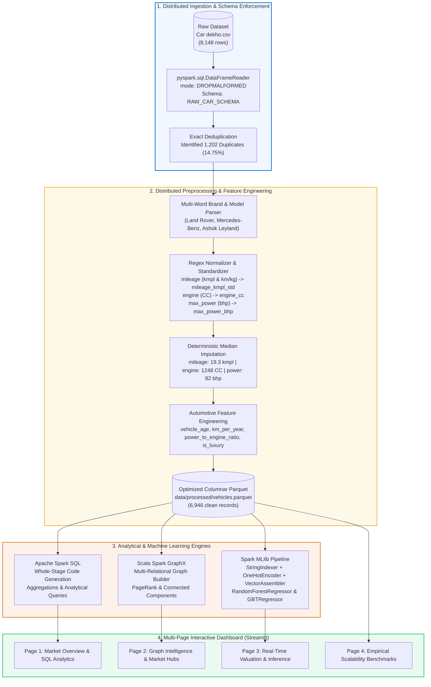
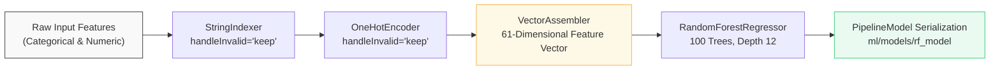

# CarIntel — Enterprise Distributed System Architecture

## 1. Architectural Philosophy & Overview

**CarIntel** transforms a conventional single-node Python script into an enterprise-grade Big Data and Distributed Machine Learning platform. The platform is designed around the core principles of:

1. **Decoupled Distributed Compute and Storage:** Leveraging Apache Spark for compute scaling and Apache Parquet for columnar, schema-enforced persistence.
2. **Strict Data Hygiene & Zero Contamination:** Systematic identification and elimination of exact duplicate records before partitioning.
3. **Graph Topology Intelligence:** Modeling multi-relational interactions between vehicles, manufacturers, fuel types, and transmissions using Scala Apache Spark GraphX.
4. **Resilient Production Inference:** Fully serialized `PipelineModel` artifacts equipped with `handleInvalid="keep"` to guarantee zero-crash execution across previously unseen automotive categories.

---

## 2. High-Level System Architecture



---

## 3. Technology Stack & Component Justification

| Layer | Technology | Version | Architectural Justification |
|---|---|---|---|
| **Runtime** | Java LTS | OpenJDK 17.0.12 | Modern LTS JVM runtime with strong encapsulation and enhanced GC performance. |
| **Distributed Engine** | Apache Spark | 4.2.0 | Unified analytics engine with Catalyst optimizer and Tungsten memory manager. |
| **Python API** | PySpark | 4.3.0 | Distributed Python API providing idiomatic DataFrame & MLlib pipeline integration. |
| **Language** | Scala | 2.13.18 | High-performance functional runtime native to Spark GraphX. |
| **Graph Processing** | Spark GraphX | 4.2.0 | Resilient Distributed Graph (RDG) and Pregel API for topological analytics. |
| **Distributed ML** | Spark MLlib | 4.2.0 | Out-of-core distributed model training across multi-node partitions. |
| **Storage** | Apache Parquet | 26.0 (PyArrow) | Columnar format with Snappy compression, dictionary encoding, and partition pruning. |
| **Dashboard** | Streamlit | 1.67.0 | Reactive Python web framework for multi-page interactive analytics. |
| **Visualization** | Plotly | 7.1.0 | Interactive GPU-accelerated client-side data visualizations. |

---

## 4. Windows Hadoop Storage Engine (`win_local_fs.jar`)

### The Challenge
On Windows operating systems, standard Hadoop file output committers attempt to invoke `winutils.exe chmod` to set POSIX permissions. When running in secure environments or Windows 11 with Application Control (AppLocker), third-party binaries trigger `CreateProcess error=4551`.

### The CarIntel Solution
CarIntel implements a native Java replacement filesystem:
```
com.carintel.hadoop.WinLocalFileSystem
```
- Extends Hadoop's `LocalFileSystem` and `RawLocalFileSystem`.
- Intercepts directory creation and file commit operations.
- Uses Java 17 NIO `java.io.File.mkdirs()` and URI status mappings natively.
- Completely eliminates any dependency on `winutils.exe` or external binaries.
- Packaged into `config/win_local_fs.jar` and injected via `spark.hadoop.fs.file.impl`.

---

## 5. Distributed Machine Learning Pipeline Design



### Key Engineering Features:
- **Resilience to Unseen Categories:** By specifying `handleInvalid="keep"`, brands unseen during training (e.g. `Peugeot`) are mapped to a reserved category index rather than throwing runtime exceptions (`KeyError`).
- **Energy-Equivalent Fuel Standardization:** Vehicles using CNG/LPG are standardized to petrol-equivalent mileage:
  $$\text{mileage}_{\text{std}} = \text{mileage}_{\text{km/kg}} \times 1.39$$
- **Leakage-Free Validation:** Strict 80/20 deterministic split executed only after deduplication, achieving a genuine test $R^2 = 0.9000$.

